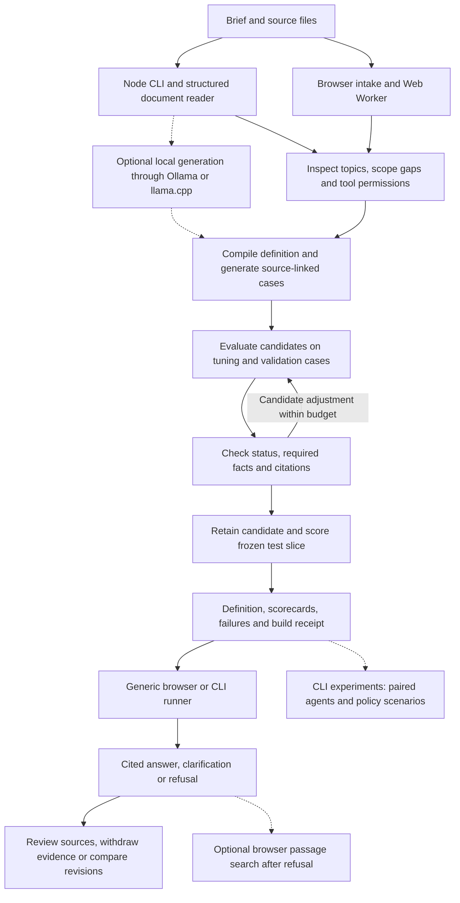

# ForgeAI Evidence Workbench

[Open the live workbench](https://forgeai-evidence-workbench.onrender.com/) · [Watch the recorded walkthrough, 3 min 41 sec](https://forgeai-evidence-workbench.onrender.com/demo/forgeai-walkthrough.mp4) · [Browse the complete implementation](https://github.com/tulasiram2005/forgeai-evidence-workbench/tree/5bd7e98)

ForgeAI turns a brief and a document folder into a runnable document agent. The factory writes requirements, selects tools, builds a passage index, generates test questions and records how the agent answered them. Reviewers can inspect the exact passage behind an answer, remove its source, or change a policy and compare the results.

The public release is an **evidence-review workbench**. Exact inventory lookups work on supported CSV layouts. Reliability on unfamiliar, naturally phrased questions remains limited. The benchmarks below show how often the agent retrieved a supported answer and how often it withheld one.

## Try the live demo with your own data

Open **New build**. Enter the brief “Help the repair desk look up inventory records in the stock register.” Under **Paste a document**, name the document `stock.csv` and paste the following text. Choose **Compile and evaluate**, then **Test the agent**.

```csv
asset ID,drawer,finish
BX-017,"West, upper",matte
BX-0170,South,polished
BX-044,North,satin
BX-044,East,satin
```

| Ask the agent | What to check |
| --- | --- |
| What is the drawer for BX-017? | The answer is **West, upper**. Its citation identifies the row for BX-017. |
| What is the drawer for BX-0170? | The answer is **South**. The final zero changes which row matches. |
| What is the drawer for BX-044? | The agent asks for clarification and shows the two matching rows. |
| What is the price for BX-017? | The agent refuses because the file has no price field. **Search passages by meaning** displays related excerpts separately. |

To verify source dependence, change **West, upper** to **Vault** in a new build and repeat the first question. The answer and cited row should both change. In the bundled shore workspace, **Remove a source** and **Change a policy** demonstrate the corresponding audit and revision views. Download the dossier before closing a custom build. Browser intake accepts TXT, Markdown and CSV. Use the CLI for PDF and DOCX.

## System architecture



**Runtime.** The web application is static HTML, CSS and JavaScript modules hosted on Render. A Web Worker compiles custom builds in the browser. Optional passage search loads the bundled MiniLM encoder and WebAssembly runtime from the same host. It combines lexical and dense ranks and presents original passages for inspection. Search results do not receive answer credit.

**Factory.** The CLI runs on Node.js. Python extracts PDF text with pypdf and reads DOCX structure. The compiler preserves source identifiers, Markdown headings and CSV columns. The registry includes CSV lookup, bounded arithmetic, current date and connected CLI weather lookup. A tool listed in a definition still requires support in the selected runtime. The CLI can use a local model for generation or run deterministically. [Compiler](https://github.com/tulasiram2005/forgeai-evidence-workbench/blob/5bd7e98/public/engine.mjs) · [Document intake](https://github.com/tulasiram2005/forgeai-evidence-workbench/blob/5bd7e98/documents.mjs) · [Browser retrieval](https://github.com/tulasiram2005/forgeai-evidence-workbench/blob/5bd7e98/public/browser-minilm.mjs)

## Local setup and first build

Use Git, Node.js 22 or later, npm and Python 3 with `venv` and pip. The following macOS/Linux commands check out the complete implementation used by the examples. The hosted pilot runs [release 601446c](https://github.com/tulasiram2005/forgeai-evidence-workbench/tree/601446c). Use that revision instead to inspect deployed behavior.

```sh
git clone https://github.com/tulasiram2005/forgeai-evidence-workbench.git
cd forgeai-evidence-workbench
git switch --detach 5bd7e98
python3 -m venv .venv
. .venv/bin/activate
python3 -m pip install -r requirements-pdf.txt
npm test
```

Build the example with a fresh output directory. This path needs no model service, API key or network after setup.

```sh
node cli.mjs forge --no-llm --brief examples/repair-desk/brief.txt --docs examples/repair-desk/docs --out runs/repair
node cli.mjs ask runs/repair/definition.json 'What is the drawer for BX-017?'
node cli.mjs audit runs/repair/definition.json 'What is the drawer for BX-017?'
```

Read `runs/repair/FINAL.md` for the verdict and limitations. Inspect `requirements.json`, `definition.json`, `evals.json`, `iterations.json`, `report.json` and `receipt.json` for the underlying requirements, cases, scores and source hashes. For a second run, choose a new output path.

**Local web interface.** Run `npm start` and open [the local workbench](http://127.0.0.1:8417). For optional local question and prompt generation, start Ollama, run `ollama pull qwen2.5:1.5b`, and repeat the forge command without `--no-llm` using a new output directory. Inspect the build notice and report to see which backend actually ran.

## Reproduce the functional checks

Run these commands from the complete implementation checkout with the virtual environment active.

| Command | Behavior exercised |
| --- | --- |
| `npm test` | Runtime regression tests followed by judge stress controls on frozen development suites. |
| `node scripts/repair-desk.mjs` | Compiles real files, compares CLI and browser-handler outputs, checks ambiguous and missing records, edits a value and removes its source. |
| `node scripts/brief-contrast.mjs` | Builds procurement and policy agents over identical files. Tests their permitted actions and deliberately corrupts a tool grant in each direction. CLI rehearsal. |
| `node scripts/scenario-rehearsal.mjs` | Exercises a single conversational request against structured Markdown policies, including missing authority, conflicting deadlines, a withdrawn policy and an unrelated scenario. CLI experiment. |
| `node scripts/evaluate-parts.mjs > replay.json` | Replays the separate-question experiment against the original questions in four development suites and emits per-case judgments. |

For an actual browser check, install the QA dependencies and Chromium. With `npm start` running in another terminal, run:

```sh
npm ci --prefix qa
qa/node_modules/.bin/playwright-core install chromium
node qa/repair-desk.mjs http://127.0.0.1:8417
```

## Results and benchmarks

The example builds use tests generated from their own documents. The prospective holdout used separate questions and preregistered criteria. These measure different things.

| Evaluation | Result | Interpretation |
| --- | --- | --- |
| Shore policy build | 27 → 31 → 32 of 36 generated cases | The released configuration improved on its own suite. [Artifacts](https://github.com/tulasiram2005/forgeai-evidence-workbench/tree/5bd7e98/evidence/shore) |
| Conservation dispatch build | 30 → 34 → 34 of 37 generated cases | The factory retained the second round and attached CSV lookup. [Artifacts](https://github.com/tulasiram2005/forgeai-evidence-workbench/tree/5bd7e98/evidence/conservation) |
| Repair-desk pilot | 10/10 authored checks | Verified record selection, refusal, clarification and response to source changes. Chromium also completed the upload, lookup and passage-search flow. [Receipts](https://github.com/tulasiram2005/forgeai-evidence-workbench/tree/5bd7e98/evidence/repair-desk) |
| Separate-question experiment | 117/255 development cases passed in both configurations | All 117 passes were refusals or clarifications. Both configurations passed 0/123 supported questions. [Case-level replay](https://github.com/tulasiram2005/forgeai-evidence-workbench/tree/5bd7e98/evidence/brief-contrast/evaluation) |
| Structured scenario experiment | 10/10 authored trials | Demonstrated scoped follow-ups with curated headings and fields. Performance on arbitrary policy prose remains unmeasured. [Trials](https://github.com/tulasiram2005/forgeai-evidence-workbench/blob/5bd7e98/evidence/scenario-review/receipt.json) |

### Prospective holdout 5

| Configuration | All cases passed | Supported answers | False answers on near misses | Balanced accuracy |
| --- | ---: | ---: | ---: | ---: |
| Always refuse | 24/60 | 0/30 | 0/24 | 50.0% |
| Always answer with the top passage | 3/60 | 3/30 | 24/24 | 5.0% |
| Contextual retrieval | 25/60 | 4/30 | 9/24 | 37.9% |
| Evidence-first | 30/60 | 0/30 | 0/24 | 50.0% |

Balanced accuracy averages supported-answer recall and refusal recall. Overall pass count also includes clarification cases. Neither candidate met the preregistered criteria for autonomous answering. These figures describe the frozen candidates. The newer exact-record lookup has separate functional evidence. [Decision rule](https://github.com/tulasiram2005/forgeai-evidence-workbench/blob/5bd7e98/evidence/prereg/holdout5.md) · [Counts and confidence intervals](https://github.com/tulasiram2005/forgeai-evidence-workbench/blob/5bd7e98/evidence/holdout5/summary.json)

## Observations and release decisions

- **Finding a passage did not guarantee an answer.** In 82 failed development cases, the hybrid retriever placed the required evidence in its top three and the agent withheld the answer. The workbench therefore lets a reviewer inspect related passages after a refusal. Whether that improves human decision accuracy or speed remains unmeasured. [Failure analysis](https://github.com/tulasiram2005/forgeai-evidence-workbench/blob/5bd7e98/evidence/funnel/summary.json)
- **The brief changed executable behavior.** The procurement agent returned a cited pack size and calculated an order quantity. The policy agent declined both operations and still quoted the receiving policy. The rehearsal exposed a calculator dispatch defect and its checks caught deliberately altered tool grants. [Side-by-side responses](https://github.com/tulasiram2005/forgeai-evidence-workbench/blob/5bd7e98/evidence/brief-contrast/results.json)
- **Human comparison remains open.** The paired rehearsal can seal cases and a comparator configuration before scoring both agents on the same extracted evidence. No independent human-authored baseline or observed time-saving result is claimed. [Rehearsal runner](https://github.com/tulasiram2005/forgeai-evidence-workbench/blob/5bd7e98/scripts/blind-rehearsal.mjs)
