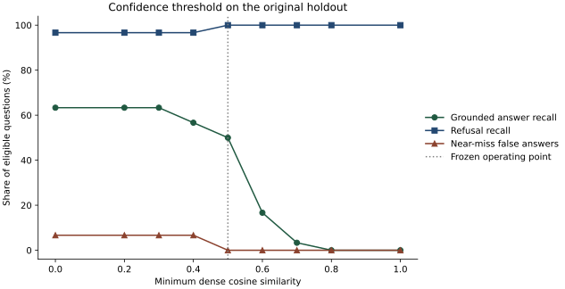

# Retrieval experiments

The release decision uses the exact frozen questions and source-backed key facts. The second corpus set was committed before scoring. Its first contextual run is archived separately. Lexical means the portable v1 deterministic configuration. Frozen means the contextual v2 CPU encoder with its original identifier gate. Normalized changes identifier matching only. Expanded adds one Qwen summary and three questions per passage to that normalized configuration. Only source text can satisfy the judge.

| Suite | Configuration | Passed | Grounded answerable recall | Refusal recall | False answers on near misses |
|---|---|---:|---:|---:|---:|
| first | lexical | 35/75 | 0/30 | 26/30 | 4/15 |
| first | frozen | 54/75 | 15/30 | 30/30 | 0/15 |
| first | normalized | 54/75 | 15/30 | 30/30 | 0/15 |
| first | expanded | 49/75 | 10/30 | 30/30 | 0/15 |
| second | lexical | 24/60 | 0/33 | 16/18 | 2/18 |
| second | frozen | 29/60 | 7/33 | 14/18 | 4/18 |
| second | normalized | 29/60 | 7/33 | 14/18 | 4/18 |
| second | expanded | 27/60 | 4/33 | 15/18 | 3/18 |

Expansion reduced total passes on both suites. The normalized identifier gate matched the frozen aggregate scores. Keep expansion opt-in. The second suite shows a cost to contextual retrieval: it answered more supported questions but gave more unsupported answers than lexical retrieval. All corpora are synthetic, and the second suite was authored in the same development session.

## False-refusal analysis for the frozen first suite

| Primary cause | Questions |
|---|---:|
| retrieval miss | 0 |
| vocabulary mismatch | 3 |
| threshold too strict | 12 |

For each refused clause, inspect the gold passage’s rank under cosine similarity. A gold passage outside the top three is a retrieval miss. Inside the top three, a correct answer after relaxing the dense floor and margin is classified as a threshold failure. Remaining top-three failures are classified as vocabulary mismatch, a ranking diagnosis rather than proof of user intent. For multi-part questions the primary label prioritizes retrieval miss, then vocabulary mismatch, then threshold. The JSON retains the clause-level evidence and alternate causes.

30 of 30 required refusals shared at least one lowercased non-stopword with the source documents. 15 of 15 near misses shared vocabulary. Other required refusals include unsupported instructions. Near-miss false-answer rate counts answered responses only; refusal recall requires an explicit refusal. Grounded answerable recall requires the expected facts and sources.

## Operating point

The sweep varies only the minimum cosine with the separation margin fixed. Lexical fallback, tool policy and explicit refusal checks still apply. Lowering both gates in the diagnostic is a separate counterfactual. The sweep uses the first suite only.

[Case evidence](error-analysis.json) · [Operating curve CSV](threshold-sweep.csv) · [Chart data](../../public/runs/threshold-sweep.json) · [Folder-level metrics](holdout-comparison.json) · [First runs on the second suite](holdout2/frozen/)
